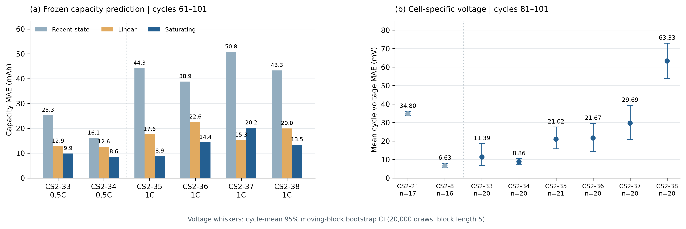

# battery

锂离子电池容量老化与负载电压–SOC 一致性分析的代码、数据和运行结果，配套研究 **Chronological validation of cell-level aging and loaded voltage-SOC consistency for evidence-controlled lithium-ion endurance analysis**。

本仓库整理了四个 Python 分析脚本、CALCE 八个 CS2 系列电芯的输入数据、逐循环预测、汇总指标、图表、运行日志和补充文档。结果来自附件中保存的 **2026-10-12 运行记录**；仓库整理与上传没有重新执行实验。

## 快速查看

- [运行结果.html](运行结果.html)：下载仓库后用浏览器打开，可查看汇总和图表。
- [本次运行说明.txt](本次运行说明.txt)：运行条件、数据来源、核验方法与结果解释。
- [本次运行汇总.csv](本次运行汇总.csv)：中文结果汇总。
- [results/multicell_summary.csv](results/multicell_summary.csv)：完整机器可读指标。
- [Supplementary Information.docx](Supplementary%20Information.docx)：论文补充材料。
- [原始结果包下载](https://github.com/lh502/battery/releases/tag/results-2026-10-12)：保留用户提供的原始 ZIP 内容，供整包下载。

GitHub 文件页通常展示 HTML 源码；请下载后在本地打开 HTML 报告。

## 文件结构

```text
battery/
├── code/
│   ├── locked_core.py        # 单电芯核心分析
│   ├── run_multicell.py      # 八电芯批量分析与汇总
│   ├── plot_results.py       # 生成四幅汇总图
│   └── build_report.py       # 生成原始 HTML 报告及汇总 CSV
├── data/                    # CALCE 原始输入及来源、哈希记录
├── core_results/            # CS2-21 与 CS2-8 的独立核心运行结果
├── results/                 # 八电芯逐循环结果、模型参数和核验记录
├── figures/                 # 四幅图，各含 PNG、PDF、SVG
├── logs/                    # 原运行日志
├── audit_run.py             # 结果复核脚本
├── remote_calce_fetch.py    # CALCE 数据获取辅助脚本
├── protocol_before_run.json # 从代码重建的本次运行配置
├── requirements.txt         # 原运行环境的依赖版本
├── SHA256SUMS               # 原 ZIP 内文件的校验清单
└── Supplementary Information.docx
```

原 ZIP 的内容已解压到仓库根目录，文件及四个分析脚本保持原样。`SHA256SUMS` 覆盖原包文件，不包含后加的本 README 和补充文档。

## 环境与复现

原记录使用 Python 3.12.14。建议在独立虚拟环境中安装附件记录的依赖；完整版本见 [requirements.txt](requirements.txt)。输入数据已经包含，分析阶段无需重新下载 CALCE 数据。

```bash
git clone https://github.com/lh502/battery.git
cd battery
python3 -m venv .venv
source .venv/bin/activate
python -m pip install -r requirements.txt

python code/locked_core.py --raw-file data/CS2_21_6_8_10.txt --output-dir core_results/CS2-21 --cell-label CS2-21
python code/locked_core.py --raw-file data/CS2_8_6_8_10.txt --output-dir core_results/CS2-8 --cell-label CS2-8
python code/run_multicell.py
python code/plot_results.py
python code/build_report.py
```

请在仓库根目录执行，保留 `code/`、`data/`、`results/` 的同级关系。重新执行会更新结果文件；`build_report.py` 还会重写 `README.txt`。原报告中的静态历史描述应结合 [本次运行说明.txt](本次运行说明.txt) 阅读。

验证原包文件完整性：

```bash
# macOS
shasum -a 256 -c SHA256SUMS
# Linux
sha256sum -c SHA256SUMS
```

## 已保存的八电芯结果

以下数值直接取自 `results/multicell_summary.csv`，保留三位小数。容量列为饱和模型在容量测试循环上的 MAE；电压列为确认窗口内共同时间区间的采样点合并 MAE。

| 电芯 | 有效循环数 | 容量 MAE / mAh | 电压确认循环数 | 独立标定电压 MAE / mV | CS2-21 曲线迁移 MAE / mV |
| --- | ---: | ---: | ---: | ---: | ---: |
| CS2-21 | 96 | 10.667 | 17 | 34.799 | 34.799 |
| CS2-8 | 95 | 4.931 | 16 | 6.628 | 97.654 |
| CS2-33 | 100 | 9.876 | 20 | 11.042 | 256.211 |
| CS2-34 | 100 | 8.587 | 20 | 8.858 | 242.555 |
| CS2-35 | 101 | 8.874 | 21 | 20.956 | 162.691 |
| CS2-36 | 100 | 14.364 | 20 | 20.826 | 167.557 |
| CS2-37 | 100 | 20.198 | 20 | 28.756 | 158.595 |
| CS2-38 | 100 | 13.453 | 20 | 62.678 | 101.377 |



独立标定电压 MAE 为 6.628–62.678 mV。将 CS2-21 的电压–SOC 曲线迁移至其他七个电芯时，MAE 为 97.654–256.211 mV；其中 CS2-8 对应 97.654 mV。

饱和容量模型没有在所有电芯上优于所有基线。例如，CS2-21 的近期基线 MAE 为 9.889 mAh，低于饱和模型的 10.667 mAh；CS2-37 的线性基线 MAE 为 15.294 mAh，低于饱和模型的 20.198 mAh。完整基线比较见汇总 CSV。

## 评价设置与解释范围

- 初始拟合使用循环 1–40，验证使用 41–60；随后用 1–60 开发循环重新拟合并冻结参数。容量测试候选窗口为 61–101，电压稳健性检查为 61–80，电压确认窗口为 81–101。实际纳入数量受记录完整性与质控影响，见逐电芯结果。
- 每个目标电芯使用自己的开发循环标定容量模型和电压关系。曲线迁移实验仍保留目标电芯自己的容量模型，因此不能解释为整套模型的零样本迁移。
- 电压关系描述带载端电压与 SOC 的关系。`U_dev(0)=3.0 V` 约束使终点时间误差属于内部一致性诊断，不能视为独立的手机关机或续航验证。
- 本包容量结果来自电压复现链中的容量诊断，不能替代论文正文的主容量实验。补充文档还讨论 GreenHub 时间负载分析；本结果包没有包含对应原始日志和完整计算链。
- 数据覆盖八个同系列电芯的有限候选循环，不能据此作全寿命、跨化学体系或总体性能结论。`protocol_before_run.json` 是从所给代码重建的运行配置，不构成预注册证明。

原包中的 [results/rerun_validation.json](results/rerun_validation.json) 记录了八电芯逐循环与汇总指标核验、两个基准电芯的独立核心结果对照，以及 12 个图文件检查。它记录的是原运行的核验结果。

## 数据来源与使用

CALCE 数据来源：[University of Maryland CALCE Battery Data](https://calce.umd.edu/battery-data)。`data/` 中保留各来源记录。请遵守原数据提供方的使用条件，并在研究中引用原始数据来源。

仓库未新增开源许可证；代码、数据与文档的再使用权限以各自权利人的授权为准。
